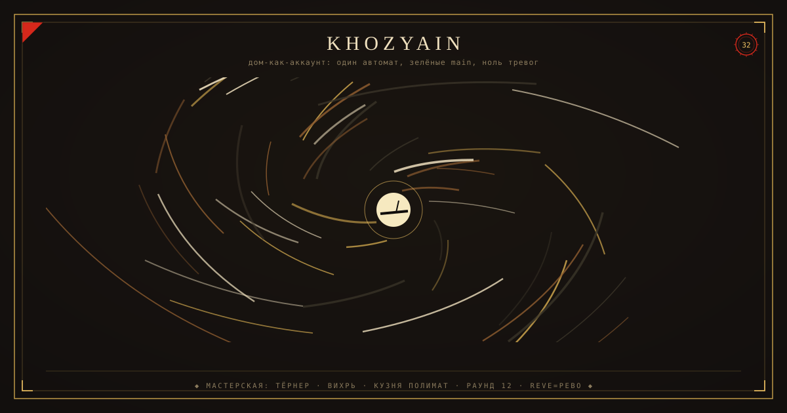
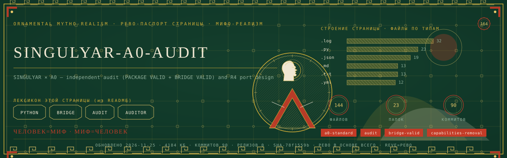

# SINGULYAR × A0 — Independent Audit Bundle

<div align="center">
  
</div>

<!--ФОРЖ:МУЗА:НАЧАЛО-->
<div align="center">
  
  <br/>
  
</div>
<!--ФОРЖ:МУЗА:КОНЕЦ-->

<!--ФОРЖ:ПАСПОРТ:НАЧАЛО-->
<div align="center">
  
</div>

| ФАЙЛОВ | ПАПОК | КОММИТОВ | ОБНОВЛЕНО | РЕЛИЗОВ |
|---:|---:|---:|---|---:|
| 106 | 17 | 30 | 2026-11-16 | 0 |
<!--ФОРЖ:ПАСПОРТ:КОНЕЦ-->


Независимый аудит **A0_STANDARD v0.2.5** и моста **a0_bridge.py** синтеза
**SINGULYAR_A0_SYNTHESIS_v1**, выполненный третьей стороной (Z.ai) по протоколу
`AUDIT_PROTOCOL.md` и статьям X1/X2 конституции редакции 2.

## Вердикты

| Объект | Статус | Отчёт |
|---|---|---|
| A0_STANDARD v0.2.5 (архив + вендорная копия в синтезе) | **PACKAGE VALID** | `reports/A0_STANDARD_v0.2.5_AUDIT_REPORT.pdf` |
| Мост `a0_bridge.py` + опыт H-020 | **BRIDGE VALID** | `reports/A0_BRIDGE_AUDIT_REPORT.pdf` |

Вместе замыкают этап **S1** дорожной карты синтеза. S2 (пересчёт `freeze_sha256`
своей реализацией RFC 8785) закрыт внутри A0-аудита как проверка A9.

## Состав

```
reports/      — два формальных PDF-отчёта (A0 + мост)
scripts/      — скрипты аудитора:
  auditor_manifest_verify.py     — A8: своя сверка манифеста
  auditor_jcs.py                 — A9: своя реализация RFC 8785
  auditor_mutations.py           — 8 собственных мутаций A0-пакета
  auditor_bridge_mutations.py    — 12 собственных мутаций моста
  generate_audit_report.py       — генератор A0-отчёта PDF
  generate_bridge_audit_report.py — генератор мост-отчёта PDF
logs/         — логи всех прогонов (A0_environment, A1–A10, мутации, verify_all, H-020, BM-A…BM-L)
```

## Как воспроизвести аудит

```bash
# 1. Чистый venv
python3 -m venv venv
source venv/bin/activate
pip install jsonschema rfc8785 rfc3339-validator rfc3986-validator pytest reportlab

# 2. Извлечь архивы A0_STANDARD_v0.2.5.zip и SINGULYAR_A0_SYNTHESIS_v1.zip

# 3. A0-аудит (A1–A10 + мутации + D1–D8)
python -B VALIDATOR.py <A0_root>
python -B run_negative_tests.py <A0_root>
python -B INTEGRITY_CHECK.py <A0_root>
python -B scripts/auditor_manifest_verify.py <A0_root>
python -B scripts/auditor_jcs.py --selftest
python -B scripts/auditor_mutations.py

# 4. Мост-аудит
cd <synthesis_root>
python tools/verify_all.py
python -B scripts/auditor_bridge_mutations.py
```

## Среда аудитора

- OS: Debian GNU/Linux 13 (trixie)
- Python: 3.12.16
- jsonschema 4.26.0, rfc8785 0.1.4, rfc3339-validator 0.1.4, rfc3986-validator 0.1.1, pytest 9.2.0, reportlab 5.1.0

## Что НЕ делает этот аудит

- Не запускает A0 (допуск — отдельное решение; мост корректно его принуждает).
- Не доказывает качество задач/рубрик A0, статистическую достаточность 44 прогонов, воспроизводимость A0 (это этап A0 REPRODUCIBLE, не PACKAGE VALID).
- Не закрывает разрыв HOST-V3 ↔ A0-ledger-V1 (наблюдатель написан тем же автором; закрывается этапом S4 — Ed25519 от отдельного ключа).

## Автомат (2026-11-16 · «на автомат всё переводи»)

Бандл аудита живёт по закону дома — по расписанию, без рук:

| Автомат | Расписание | Что делает |
|---|---|---|
| `.github/workflows/a0-audit-watch.yml` | понедельник 09:11 UTC + диспетч | «СТРАЖ ВЕРДИКТОВ A0»: py_compile 10 скриптов аудитора и r4_implementation; самотест JCS 7/7 (RFC 8785 §3.2.3); `sha256sum -c SHA256SUMS.txt` — 41 вердикт-носитель байт-в-байт |
| `.github/workflows/revo-obhod.yml` | понедельник 09:00 UTC + диспетч | дежурный обход РЕВО: пять вещей (banner, муза, делитель, муза-блок README, AGENTS.md со сводом); при дрейфе — issue |
| `.github/dependabot.yml` | еженедельно | экосистемы github-actions и pip; bump-волны как во всём доме (группировка, SHA-пины — W7/W8) |

**Страж вердиктов.** `SHA256SUMS.txt` запечатывает всё, из чего состоят вердикты
PACKAGE VALID (A0_STANDARD v0.2.5) и BRIDGE VALID (`a0_bridge.py` + опыт H-020):
`reports/` (2 PDF), `logs/` (27 логов), `r4_implementation/` (5 файлов),
`scripts/` (6 скриптов), `R4_X019_DESIGN.md`. Любое байт-изменение вердикт-носителя
красит workflow — тишина = айс.

**Полный перепрогон A1–A10 и моста** требует пакетов `A0_STANDARD_v0.2.5.zip` и
`SINGULYAR_A0_SYNTHESIS_v1.zip`: архивы были эфемерной средой аудита и в бандл не
входят. Для повторного аудита владелец кладёт их в релиз `audit-inputs/v1` этого
репо; страж вердиктов от них не зависит.

## Лицензия / авторство

Аудиторские скрипты и отчёты — Z.ai, 2026. Проверяемый код (A0_STANDARD v0.2.5, SINGULYAR HOST v4.1, конституция редакции 2) — не изменён аудитором; лицензия оригинальных авторов.
